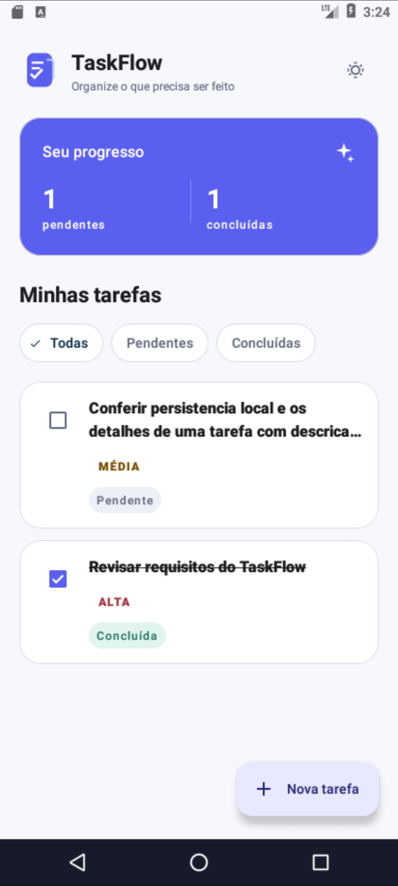
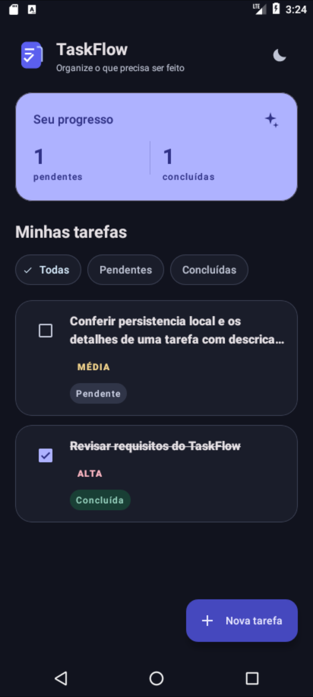

# TaskFlow — 1.0.0

Aplicativo Android nativo para organizar tarefas pessoais, com descrição, prioridade e acompanhamento de conclusão. O objetivo é demonstrar um CRUD completo com persistência local, interface Material Design 3 e navegação entre Activities, mantendo uma implementação acadêmica simples em **Java e layouts XML**.

## Contexto acadêmico

- **Aluno e autor:** Eduardo Caversan da Silva Rocha
- **R.A.:** 2475391
- **Curso:** Engenharia de Software
- **Instituição:** Universidade Tecnológica Federal do Paraná — UTFPR
- **Câmpus:** Cornélio Procópio
- **Disciplina:** Programação para Dispositivos Móveis

A entrega final parte da `master` após o merge da `entrega-3` pelo PR #2. O desenvolvimento desta revisão está na branch `entrega-final`; as branches acadêmicas anteriores foram preservadas. Apresentação, slides e vídeo não fazem parte desta revisão técnica.

## Funcionalidades

- Cadastro com descrição obrigatória, normalização dos espaços nas extremidades e prioridade Baixa, Média ou Alta.
- Lista ordenada por pendência e ID mais recente, detalhes e edição de descrição, prioridade e status.
- Marcação como concluída ou pendente diretamente na lista.
- Exclusão com confirmação e possibilidade de cancelar.
- Contadores globais de pendentes e concluídas; filtros Todas, Pendentes e Concluídas.
- Estados vazios específicos e feedback de criação, atualização, exclusão e falha.
- Proteção contra envio duplicado e preservação do formulário durante recriação da Activity.
- Splash, logo e ícones próprios; tema claro, escuro e opção de acompanhar o sistema.
- Preferência de tema persistida; telas roláveis e controles com labels e áreas de toque revisadas.
- Operação totalmente offline, sem login, backend, Firebase, anúncios ou analytics.

## Tecnologias e ambiente

| Item | Configuração |
| --- | --- |
| Linguagem do aplicativo | Java; source/target compatibility 11 |
| Interface | XML, AppCompat 1.6.1 e Material Components 1.10.0, tema Material 3 |
| Persistência | Room 2.7.2 sobre SQLite |
| Android mínimo | Android 7.0, API 24 |
| compileSdk / targetSdk | 37 / 37 |
| Gradle / Android Gradle Plugin | Wrapper 9.5.0 / AGP 9.3.3 |
| JVM do Gradle | JDK 25, conforme `gradle/gradle-daemon-jvm.properties` |
| Testes | JUnit 4.13.2, AndroidX Test JUnit 1.1.5, Espresso 3.5.1 |

Use Android Studio compatível com o AGP declarado, SDK Platform 37, SDK Build Tools e Platform Tools. O JDK 11 descreve a compatibilidade do código, **não** o JDK necessário para executar este Gradle. Configure JDK 25 como Gradle JDK, ou permita o provisionamento de toolchain configurado no projeto. No ambiente validado, o wrapper foi iniciado pelo JDK 17 e o daemon usou Java 25.

A primeira sincronização requer internet para baixar ferramentas e dependências. O aplicativo instalado não requer internet nem solicita permissões de rede.

## Arquitetura e estrutura

```text
app/
  build.gradle.kts
  schemas/com.eduardocaversan.taskflow.TaskDatabase/1.json
  src/main/
    AndroidManifest.xml
    java/com/eduardocaversan/taskflow/
      Task.java, TaskDao.java, TaskDatabase.java, TaskRepository.java
      TaskRules.java, TaskEditorState.java, ThemePreferences.java
      TaskFlowApplication.java, ScreenInsets.java
      SplashActivity.java, MainActivity.java
      TaskFormActivity.java, TaskDetailActivity.java
    res/                     # layouts, temas, strings, cores, ícones e backup
  src/test/                  # regras Java
  src/androidTest/           # Room, repository, estado de tela e Espresso
docs/                        # arquitetura, auditoria, testes e entrega
gradle/                      # catálogo de versões, toolchain e wrapper
gradlew, gradlew.bat          # wrappers Linux/macOS e Windows
```

As Activities chamam o `TaskRepository`, que executa o DAO fora da main thread e entrega sucesso ou erro na UI. `TaskEditorState` preserva a operação em andamento durante recriação; `TaskRules` centraliza regras pequenas e testáveis. Veja o diagrama e as decisões em [ARCHITECTURE.md](docs/ARCHITECTURE.md).

## Persistência e fluxo do CRUD

O banco local é **`taskflow.db`**, tabela `tasks`, schema versão **1**. A revisão preserva a estrutura anterior, sem fallback destrutivo, sem consultas na main thread e sem apagar tarefas durante atualização normal.

1. **Criar:** Main → Nova tarefa → validar → inserir pelo repository → confirmar sucesso → retornar à Main.
2. **Consultar:** o repository lista as tarefas; a Main calcula os contadores globais e aplica o filtro selecionado.
3. **Atualizar:** tocar na tarefa carrega seu ID; salvar atualiza apenas esse registro. O CheckBox da lista altera somente o status.
4. **Excluir:** Detalhes → Excluir → confirmar → remover e retornar. Cancelar não altera dados; falha mantém a tela aberta.

O singleton usa Application Context. As operações são serializadas e exceções são registradas e comunicadas à interface. O banco permanece entre aberturas do aplicativo. Backup automático e transferência automática estão desabilitados para manter os dados exclusivamente locais; desinstalar ou limpar dados remove tarefas e preferências.

## Temas

O botão de tema abre as opções Sistema, Claro e Escuro. A escolha fica em `SharedPreferences` e é aplicada por `TaskFlowApplication` antes das Activities. O tema pode recriar a tela; o filtro e os dados permanecem. Prioridades e status têm texto e cores próprias para os dois temas.

## Clonar, abrir e executar

```bash
git clone https://github.com/EduardoCaversan/TaskFlow.git
cd TaskFlow
git switch entrega-final
```

A branch precisa estar publicada no remoto para o último comando funcionar. Para a entrega em ZIP, extraia o arquivo e abra a pasta que contém `settings.gradle.kts`.

No Android Studio, use **Open**, selecione a pasta do projeto e aguarde a sincronização. Configure o caminho do SDK local pela IDE (o arquivo `local.properties` não é distribuído). Escolha o módulo `app`, um emulador ou dispositivo com API 24 ou superior e execute **Run**.

## Build e testes

No Windows, em PowerShell na raiz:

```powershell
.\gradlew.bat clean
.\gradlew.bat test
.\gradlew.bat lint
.\gradlew.bat assembleDebug
.\gradlew.bat assembleRelease
.\gradlew.bat connectedAndroidTest
```

No Linux/macOS:

```bash
chmod +x gradlew
./gradlew clean
./gradlew test
./gradlew lint
./gradlew assembleDebug
./gradlew assembleRelease
./gradlew connectedAndroidTest
```

`connectedAndroidTest` requer dispositivo/emulador conectado e dedicado a testes, pois o runner pode reinstalar/desinstalar o aplicativo. Os testes de banco usam Room in-memory, além de um arquivo exclusivo de teste para validar reabertura. Os testes de UI criam tarefas com identificador próprio e sua limpeza remove somente essas tarefas.

- **APK debug instalável:** `app/build/outputs/apk/debug/app-debug.apk`
- **APK release sem assinatura de distribuição:** `app/build/outputs/apk/release/app-release-unsigned.apk`
- **Testes locais:** `app/build/reports/tests/testDebugUnitTest/index.html`
- **Lint:** `app/build/reports/lint-results-debug.html`
- **Instrumentados:** `app/build/reports/androidTests/connected/debug/index.html`

Não há chave privada de assinatura no repositório. O debug usa a chave de desenvolvimento gerada pelo Android SDK. Para instalar manualmente: `adb install -r app/build/outputs/apk/debug/app-debug.apk`.

Consulte [TESTING.md](docs/TESTING.md) para casos, resultados efetivos, configurações de tela e limitações. A [matriz de auditoria](docs/AUDIT.md) registra o diagnóstico inicial; [FINAL_DELIVERY.md](docs/FINAL_DELIVERY.md) reúne as evidências finais e os commits. As mudanças estão no [CHANGELOG.md](CHANGELOG.md).

## Limitações e decisões

O aplicativo é destinado ao volume de tarefas de um projeto acadêmico: a lista carrega todos os registros, sem paginação. Não há sincronização, exportação ou recuperação após desinstalação. Uma escrita em andamento sobrevive à rotação, mas não há garantia de continuar executando após o sistema matar o processo; nesse caso, confira a listagem antes de reenviar.

A splash própria foi mantida como requisito; Android 12+ também possui sua tela de inicialização do sistema. As versões das dependências foram preservadas após validação, sem atualizações amplas apenas para eliminar avisos de disponibilidade. A navegação antiga foi substituída por Activity Result APIs.

## Capturas reais

Capturas da versão final no emulador API 24, área lógica 412 × 915. Outras configurações estão documentadas em [TESTING.md](docs/TESTING.md).

| Claro | Escuro |
| --- | --- |
|  |  |

## Autor

Eduardo Caversan da Silva Rocha — R.A. 2475391. Engenharia de Software, UTFPR, Câmpus Cornélio Procópio. [Repositório no GitHub](https://github.com/EduardoCaversan/TaskFlow).
