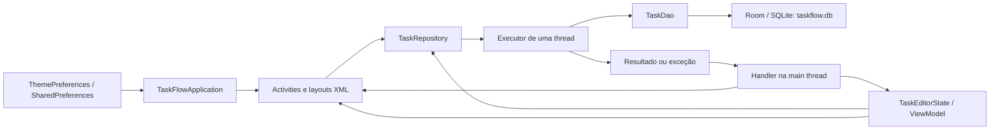

# Arquitetura

O TaskFlow é um aplicativo Android nativo, em Java e XML, com um único módulo `app`. Não usa backend, autenticação nem permissão de internet. A identidade visual original e os componentes Material Design 3 foram preservados.

## Componentes

| Componente | Responsabilidade |
| --- | --- |
| `Task` | Entidade da tabela `tasks`: ID autogerado, descrição, prioridade e conclusão. |
| `TaskDao` | Inserir, listar, buscar por ID, editar, alterar status e excluir. Escritas de registros existentes retornam o número de linhas afetadas. |
| `TaskDatabase` | Singleton com `volatile`, sincronização e Application Context; Room versão 1. |
| `TaskRepository` | Executor serial, validação na escrita, retorno assíncrono de sucesso/erro e registro técnico com `Log.e`. |
| `TaskRules` | Normalização de descrição, prioridades válidas, filtros, contagem e cópia validada da tarefa. Java sem dependência de UI. |
| `TaskEditorState` | Pequeno ViewModel compartilhado pelos dois formulários. Preserva a operação em andamento durante recriação e bloqueia reenvio. Não guarda Activity, View ou Context. |
| `MainActivity` | Listagem, contadores globais, filtros, alteração rápida de status e seletor de tema. |
| `TaskFormActivity` | Cadastro, validação de campos e feedback após confirmação do banco. |
| `TaskDetailActivity` | Carga pelo ID, edição, status e confirmação de exclusão. |
| `SplashActivity` | Exibe a marca; abre Main e encerra. Cancela o temporizador quando sai de primeiro plano. |
| `ScreenInsets` | Em API 35+, reserva barras, recortes e teclado. Antes disso, usa o decor e `adjustResize` nativos. |
| `ThemePreferences` | Preferência `system`, `light` ou `dark` em `taskflow_preferences`. |
| `TaskFlowApplication` | Aplica a preferência antes da criação das Activities. |

## Persistência e integridade

O banco se chama **`taskflow.db`**. O schema permanece na versão **1**, com a mesma estrutura das entregas anteriores. O JSON em `app/schemas/com.eduardocaversan.taskflow.TaskDatabase/1.json` documenta a estrutura, sem modificar dados existentes. Não há `allowMainThreadQueries`, fallback destrutivo ou migração desnecessária.

As tarefas são ordenadas por `completed ASC, id DESC`: pendentes primeiro; dentro de cada status, as mais recentes primeiro. O filtro é aplicado à lista completa, de modo que os contadores sempre representem o banco inteiro.

Inserções usam `ABORT`, evitando substituição silenciosa por conflito de ID. Atualizações e exclusões só geram sucesso quando exatamente uma linha é afetada. Edição cria uma cópia com o mesmo ID, em vez de alterar o objeto carregado antes da confirmação. Descrição é normalizada e prioridade validada novamente na fronteira do repository.

Backup automático e transferência automática estão desabilitados explicitamente. Os dados são locais: desinstalar ou limpar os dados do aplicativo remove tarefas e preferências. Uma atualização normal do APK, com mesmo pacote e assinatura compatível, preserva o banco.

## Concorrência e ciclo de vida

Um `Executor` de uma única thread serializa consultas e escritas. O repository entrega `(valor, erro)` pelo `Handler` da main thread; a UI nunca consulta o DAO diretamente. O contador interno de operações permite sincronização dos testes Espresso até a entrega dos callbacks, sem sleeps arbitrários.

Os formulários observam `LiveData` do `TaskEditorState` com o próprio lifecycle. A operação continua durante rotação, e o resultado chega à nova instância. Salvar/excluir bloqueia reenvio, edição e navegação até o resultado. Em falha, os controles são liberados e o rascunho permanece. O estado nativo das Views preserva texto e Spinners; a edição não reaplica os dados do banco por cima de um formulário restaurado.

Na lista, uma geração de consulta descarta respostas antigas; callbacks verificam se a Activity já foi destruída. A alteração de status bloqueia aquela tarefa, reverte o CheckBox em erro e recarrega os registros. O listener é instalado depois do valor inicial do CheckBox. A lista é reconstruída a partir do resultado, sem acumular itens.

O ViewModel sobrevive à recriação de Activity, não à morte do processo. SQLite mantém a atomicidade das escritas; após encerramento forçado durante uma escrita, o usuário deve conferir a listagem antes de reenviar o formulário. Não há promessa de executar trabalho após o processo ser encerrado.

## Erros e navegação

Exceções de persistência são registradas para diagnóstico e retornadas à tela. A interface usa mensagens de recursos, sem stack traces. Falha ao carregar oferece nova tentativa; falha ao salvar/excluir mantém a tela aberta. ID inexistente retorna à lista com feedback específico.

A navegação usa `ActivityResultLauncher` e `finish()`, retornando feedback à Main existente. Um bloqueio de navegação evita abertura duplicada por toque rápido. O filtro é salvo em `Bundle`, usando um enum independente do texto exibido.

As escolhas seguem as APIs oficiais de [resultados de Activities](https://developer.android.com/training/basics/intents/result) e [insets em Views](https://developer.android.com/develop/ui/views/layout/edge-to-edge).

## Temas e UI

`AppCompatDelegate` aplica claro, escuro ou sistema. A preferência é gravada com `SharedPreferences.apply()` e lida na inicialização. Cores de prioridade e status têm variantes noturnas e rótulos textuais; não dependem apenas de cor. Os layouts têm rolagem, alvos de toque de pelo menos 48dp nos controles revisados e descrição abreviada em duas linhas na lista; o formulário exibe o conteúdo completo.

Mantém-se uma lista simples de Views, adequada ao escopo acadêmico. Não há paginação nem otimização para milhares de registros. Não foram adicionadas bibliotecas de DI, RxJava, múltiplos módulos ou camadas de arquitetura sem necessidade.
